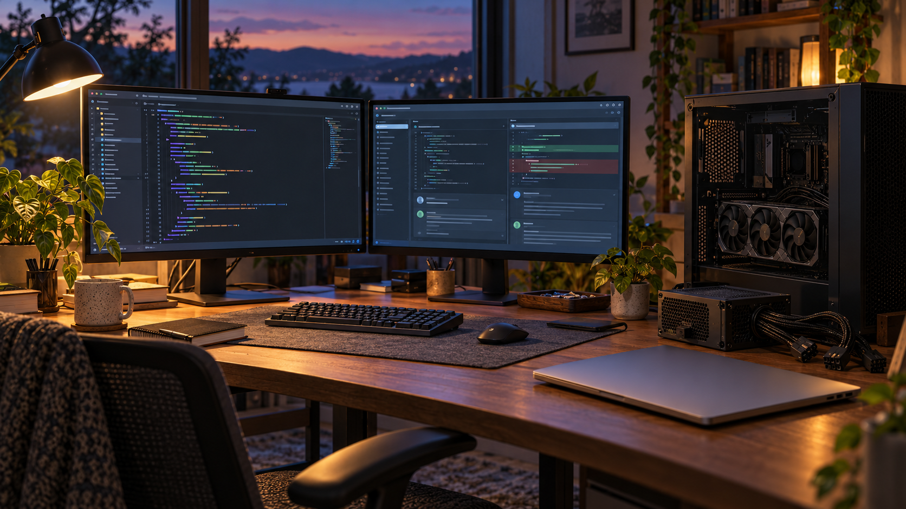

+++
date = '2026-10-11'
draft = false
title = 'Why I Am Running Both Codex and Claude Code'
summary = 'Local AI was good, a dead power supply ended the experiment, and two frontier AI subscriptions now anchor my development workflow.'
images = ['dual-ai-workflow.png']
categories = ['AI Workflow', 'Homelab']
tags = ['codex', 'claude-code', 'hermes', 'local-llm', 'ai-development']
+++

## Local AI was good. The frontier labs are still better.

I am now paying for both Codex and Claude Code. After spending time trying to make local AI my primary setup, that is where I have landed.

The local experiment was pretty good. I tested Gemma 4 and Qwen 3.8 on my PC with a 5090 and on my M4 MacBook with 48 GB of memory. This was hardware I could actually use to explore what local models could do, rather than just read about someone else's results.

But pretty good was not stellar enough to make me abandon the frontier labs entirely. For the work I want AI to help me do, the hosted models are still too good. I could get useful results locally without feeling ready to give up what I had with the frontier tools.

Then I managed to kill my PC's 1,000-watt power supply.

That ended my local AI experiments. There is something clarifying about a hardware failure: it turns an ongoing comparison into a much more immediate decision about what I want to spend my time and money on next.

I had already been [building a local Hermes setup](), so this is a change in direction from that earlier post. The experiment was worthwhile. It just did not become a replacement for the frontier labs.

## The subscription math is hard to beat

At $20 a month each, Codex and Claude Code cost me $40 a month together. For what I get out of them, that value is hard to replicate locally.

There is also my Nous Research subscription for Hermes. Count that, and there are three $20-a-month subscriptions in the picture.

Those are my costs and my assessment of the value. I am not trying to turn this into a universal price-to-performance benchmark. My local setup had to compete with tools I already found useful, at a monthly cost I could justify. It never became compelling enough for me to leave those tools behind.

The hardware failure brought that decision forward, but the quality gap was already part of it.

## Codex starts the work. Claude Code reviews it.

Claude Code has surprised me lately. On quite a few tasks, it has even surpassed what I was getting from Codex.

That has made the second subscription useful for more than extra capacity. I now have another tool whose judgment I want in the workflow.

Still, my AI development workflow starts with **Codex**, and **Claude Code becomes the reviewer**. That is the division of labor I keep coming back to, even when Claude does better on an individual task.

Most of my time is spent using **GPT 5.5/5.6/6.1 Sol** and **Sonnet 5.5 High**. I care more about how they perform on the work in front of me than about picking one permanent winner. Having both available gives me room to compare their results and use a second perspective before I settle on a change.

## Hermes gets another look when the limits return

Hermes is still in the picture. My setup now uses API billing, and the amount I do through it comes in at less than $20 a month as well.

I plan to review Hermes again in the coming months, once I end up hitting usage limits on my two main subscriptions again. That will be a useful time to revisit how much work I want to route through it and how the API costs hold up with more usage.

For now, I am comfortable with where this landed: Codex to start, Claude Code to review, and Hermes available through the API. Local AI gave me a useful experiment and a dead PSU. The frontier tools are giving me enough value that I am happy to keep paying for them.
